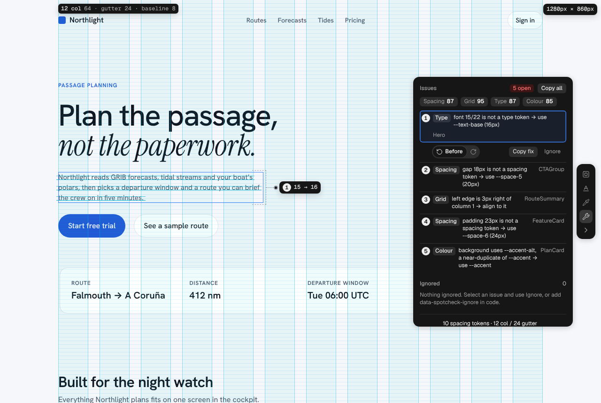
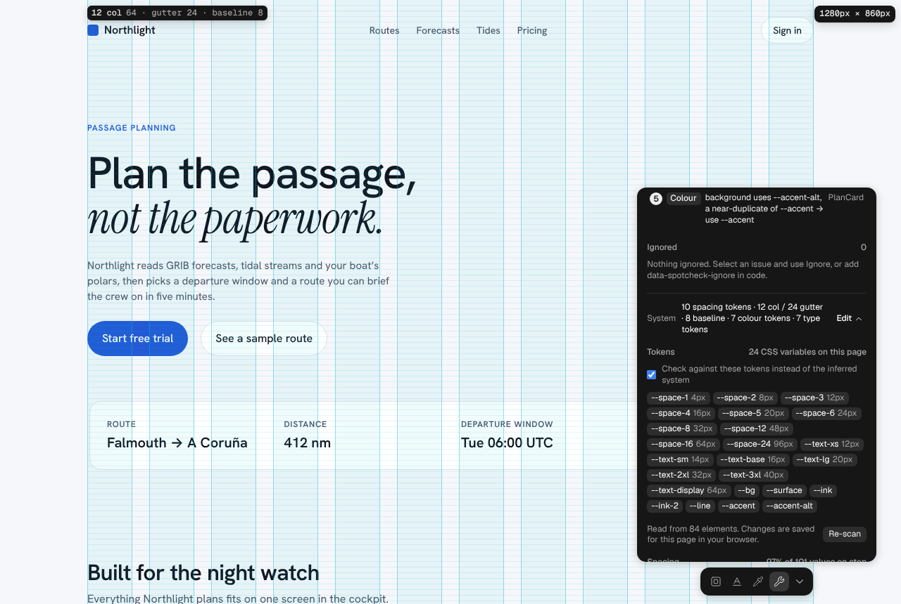

# react-spotcheck

A dev-only overlay that shows how a React page is built (spacing, grid, type, colour) and flags where it drifts from its own design system or its CSS tokens. Press **⌥⇧G**.

It is read-only. It never changes your source: it shows, scores, previews a fix on the page, and copies a fix instruction you can paste into Claude Code, Cursor or similar.



Works alongside [react-grab](https://github.com/aidenybai/react-grab): react-grab copies what an element *is*, react-spotcheck copies what to *change* about it.

## Install

```sh
npm i -D react-spotcheck
```

### Vite, Create React App and other client entry points

```jsx
// main.jsx
import { Spotcheck } from 'react-spotcheck';

createRoot(document.getElementById('root')).render(
  <StrictMode>
    <App />
    <Spotcheck />
  </StrictMode>
);
```

Or without JSX: `import { init } from 'react-spotcheck'; init();`

### Next.js (App Router)

```jsx
// app/layout.jsx
import { Spotcheck } from 'react-spotcheck';

export default function RootLayout({ children }) {
  return <html><body>{children}<Spotcheck /></body></html>;
}
```

The component is marked `"use client"` and renders nothing on the server.

### Script tag

```html
<script src="https://unpkg.com/react-spotcheck/dist/react-spotcheck.global.js" data-root="#root"></script>
```

Add `data-manual` to mount it yourself later with `ReactSpotcheck.init()`.

## Production

Production builds get an empty stub through the `production` export condition (Vite, webpack 5 and Next.js set it), so nothing ships. Imported on the server, `init()` returns a no-op.

## Using it

| | |
|---|---|
| **⌥⇧G** | Turn the overlay on or off. The column and baseline grid is always drawn while it is on. |
| **Toolbar** | Spacing, Type and Colour layers, and the wrench for issues and the system. Docked on the right by default; drag it to any edge. Collapse it to turn the tool off. |
| **Hover** | Specs for any element, labelled with its React component. **⌥-click** pins it. |
| **Keyboard** | Tab focus inspects; ⌥⇧ + arrows walk the tree; ⌥⇧Enter pins; Shift + arrows move the toolbar. |
| **Issues** | Numbered in reading order. Select one to see its marker, preview the fix (Before / After), copy it, or ignore it. |

### What it checks

- **Spacing:** padding, margin and gap off the spacing scale.
- **Grid:** edges 1–8px off a column.
- **Type:** sizes off the type scale.
- **Colour:** near-duplicates of palette colours.

### Tokens

If the page declares CSS variables on `:root` or `html` (hand-written, or Tailwind v4 `@theme`), they are used instead of the inferred system:

- variables named like `--space-*`, `--gap-*` or `--spacing-*` become spacing tokens;
- variables named like `--text-*`, `--font-size-*` or `--heading-*` become type tokens;
- any colour value becomes a colour token;
- Tailwind v4's single `--spacing` unit becomes the spacing step.

A category needs at least three tokens to be checked against them. **Edit** in the panel lists the tokens found and can switch back to the inferred system. Values the page never styled (browser defaults) are not flagged.



### Scores

Each check gets a 0–100 score: the share of distinct values in use that are on the system, weighted by how far off each one is. Grid counts elements. 100 means nothing is open, and a fix shows its gain, e.g. **Spacing 93 ↑6**.

## Options

```ts
init({
  root: document.getElementById('root'), // subtree to scan; default document.body
  hotkey: 'alt+shift+g',                 // physical key, so it works on every layout
  open: true,                            // override the remembered on/off state
  testHook: true                         // expose window.__spotcheck (read-only)
});
```

`init()` mounts once per page and returns `{ issues, system, rescan, destroy }`. `destroy()` removes the overlay, its listeners and any previewed style. Toolbar position, ignored issues and system edits are saved per page in localStorage.

## Requirements and limits

- A development build of React 18 or 19 for component names. It still works without React, labelling elements by tag and class.
- Reads computed styles in the browser, so it checks what renders, not your source.
- Grid inference guesses columns from edges and CSS grid tracks; correct it under Edit if needed.
- Not yet supported: W3C design-tokens JSON via `init({ tokens })` (planned for 1.1) and Tailwind v3 config.

## Development

The overlay is developed as a single-file prototype (`prototype/react-spotcheck.html`) with a sample app. `npm run extract` turns it into `src/core.js`; `npm test` builds and runs a planted-issue benchmark (15 issues) and a StrictMode lifecycle test in headless Chromium.

## Licence

Copyright (c) 2026 lary-thmetic. All rights reserved: no open-source licence is granted yet, so the code can be viewed and installed for evaluation but not reused or redistributed. A licence will be chosen before 1.0.

The bundled icons come from [Lucide](https://lucide.dev) under their own licences (ISC; two Feather-derived icons, MIT); see [THIRD_PARTY_NOTICES.md](THIRD_PARTY_NOTICES.md).
